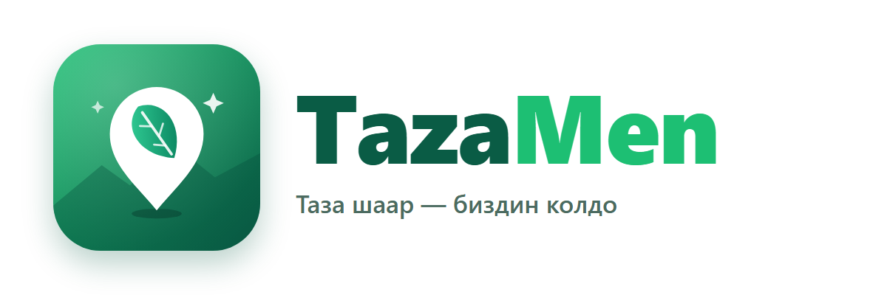
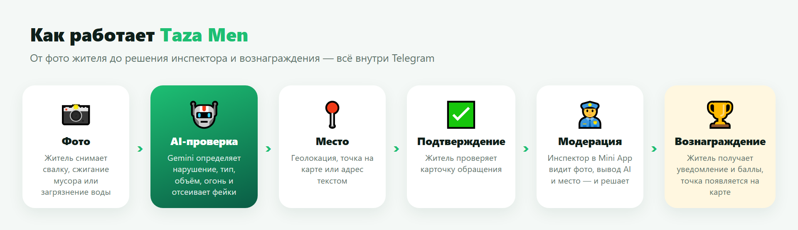
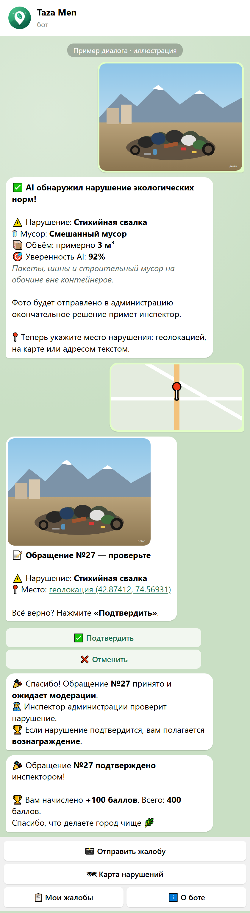
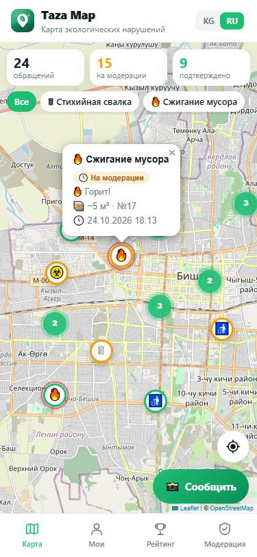
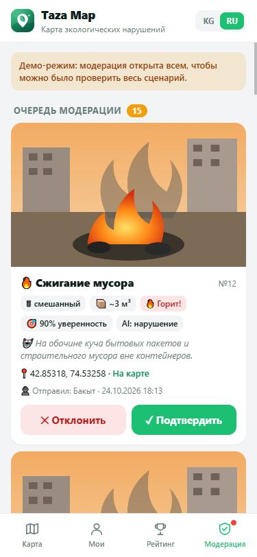
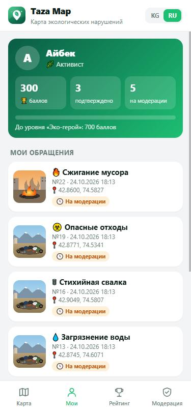
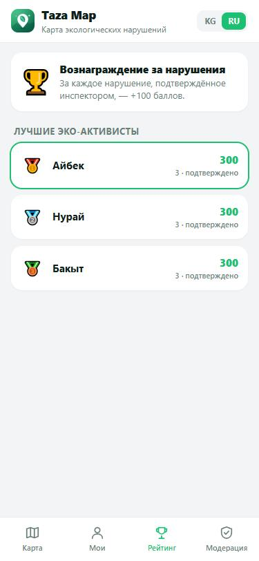
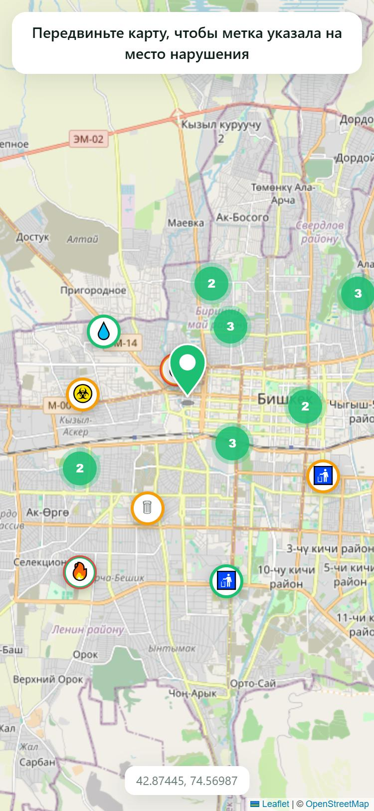
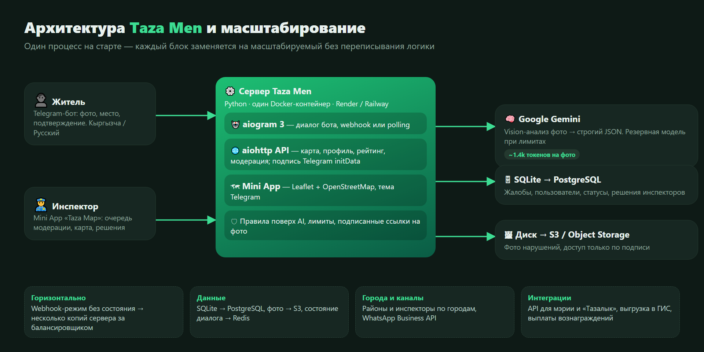

<p align="center"></p>

<p align="center">
  <b>Гражданский эко-контроль в Telegram.</b><br>
  Житель фотографирует свалку → AI проверяет → инспектор решает → житель получает вознаграждение.
</p>

<p align="center">
  🇰🇬 Кыргызча · 🇷🇺 Русский · 🤖 Google Gemini · 🗺 Telegram Mini App · 🐳 Docker
</p>

---

## Проблема

В Кыргызстане всё ещё **больше 230 стихийных свалок**, мусор жгут во дворах и выбрасывают в арыки.
Жители видят нарушения каждый день, но сообщить о них неудобно: непонятно, куда писать, жалобы теряются,
а инспекторы тонут в ручной обработке. В 2026 году мэрия Бишкека предложила **вознаграждать граждан**
за достоверные сообщения о нарушениях в сфере санитарии и обращения с отходами — нужен инструмент, который
сделает это быстро, честно и без фейков.

## Решение

**Taza Men** — бот, которому достаточно одного фото. Ничего не нужно устанавливать: всё работает внутри Telegram.

<p align="center"></p>

| | |
|---|---|
| 📸 **Одно фото** | Житель просто присылает снимок. Из альбома берётся только первое фото |
| 🤖 **AI-фильтр** | Gemini определяет, есть ли нарушение экологических норм, его тип, объём, горит ли мусор, и отсеивает скриншоты и картинки из интернета |
| 📍 **Место за секунду** | Геолокация, точка на карте прямо в Telegram или адрес текстом |
| ✅ **Подтверждение** | Житель видит карточку обращения и подтверждает её кнопкой |
| 👮 **Решает человек** | Окончательное решение принимает инспектор, а не AI |
| 🏆 **Вознаграждение** | За подтверждённое нарушение житель получает баллы и уведомление |
| 🗺 **Taza Map** | Карта всех нарушений, профиль, рейтинг активистов и панель модерации — в Mini App |

## Как это выглядит

<table>
<tr>
<td width="34%" valign="top"><br><sub>Диалог с ботом (иллюстрация с реальными текстами бота)</sub></td>
<td valign="top">
<table>
<tr>
<td><br><sub>🗺 Карта нарушений</sub></td>
<td><br><sub>👮 Модерация для инспектора</sub></td>
<td><br><sub>👤 Профиль и баллы</sub></td>
</tr>
<tr>
<td><br><sub>🏆 Рейтинг активистов</sub></td>
<td><br><sub>📍 Выбор места на карте</sub></td>
<td></td>
</tr>
</table>
<sub>Скриншоты Mini App сделаны на демо-данных.</sub>
</td>
</tr>
</table>

## Почему это удобно

- **Ноль установки.** Telegram уже есть у всех — бот и карта открываются в один тап.
- **Два языка.** Весь интерфейс и ответы AI — на кыргызском и русском.
- **Быстро.** Анализ фото ~3–5 секунд, вся жалоба — меньше минуты.
- **Честно.** AI отсекает фейки, решение принимает инспектор, житель видит статус каждой жалобы.
- **Мотивация.** Баллы, уровни (Новичок → Активист → Эко-герой → Хранитель города) и рейтинг.
- **Инспектору не нужна отдельная система.** Очередь модерации с фото, выводом AI и картой — в том же Telegram.

## AI: как проверяется фото

Фото отправляется в Google Gemini с промптом эколога-инспектора ([bot/ai.py](bot/ai.py)). Модель возвращает **строгий JSON**:

```json
{
  "is_violation": true,
  "violation_type": "illegal_dump",
  "waste_type": "mixed",
  "volume_m3": 3.0,
  "burning": false,
  "people_or_plates": false,
  "looks_fake": false,
  "confidence": 0.92,
  "verdict": "accept",
  "reason_ky": "...",
  "reason_ru": "Пакеты, шины и строительный мусор на обочине вне контейнеров."
}
```

- **Типы нарушений:** стихийная свалка, сжигание мусора, загрязнение воды, опасные отходы, переполненный контейнер.
- **Модели не доверяем вслепую:** код перепроверяет ответ — фейк или нет нарушения → отказ, низкая уверенность → ручная проверка.
- **Экономно:** короткое «обдумывание» и среднее разрешение фото — ~1.4 тыс. токенов на фото, работает на бесплатном тарифе.
- **Надёжно:** если основная модель упёрлась в лимит — резервная; если AI недоступен — жалоба не теряется, а уходит инспектору.

## Безопасность

- Все запросы Mini App подписаны Telegram (`initData`) и проверяются на сервере.
- Фото нарушений не публикуются: доступ только по подписанной ссылке, на общей карте — лишь точки.
- Вебхук защищён секретным токеном, лимит фото в день на пользователя, ключи только в переменных окружения.

## Архитектура и масштабирование

<p align="center"></p>

Сейчас всё работает в **одном Docker-контейнере** — это просто и дёшево для пилота. При этом каждый блок
заменяется на масштабируемый без переписывания логики:

| Что | Сейчас | При росте |
|---|---|---|
| Приём сообщений | polling локально, **webhook** на хостинге | несколько копий сервера за балансировщиком |
| База | SQLite | PostgreSQL (слой `bot/db.py` изолирован) |
| Фото | диск | S3 / Object Storage |
| Состояние диалога | в памяти | Redis (aiogram `RedisStorage`) |
| Города | Бишкек | районы, инспекторы и карты по городам |
| Каналы | Telegram | WhatsApp Business API, веб-форма |
| Интеграции | — | API для мэрии и «Тазалык», выгрузка в ГИС, выплата вознаграждений |

## Технологии

Python 3.12 · aiogram 3 · aiohttp · Google Gemini (`google-genai`) · SQLite (aiosqlite) ·
Telegram Mini App · Leaflet + OpenStreetMap · Docker

## Запуск локально

```bash
python -m venv .venv
.venv\Scripts\activate          # Windows
# source .venv/bin/activate     # Linux/macOS
pip install -r requirements.txt
copy .env.example .env          # заполните BOT_TOKEN и GEMINI_API_KEY
python -m bot
```

- Токен бота — у [@BotFather](https://t.me/BotFather), ключ Gemini — на [aistudio.google.com/apikey](https://aistudio.google.com/apikey).
- Локально бот работает через polling. Чтобы открыть Mini App, нужен HTTPS-адрес: например,
  `ssh -R 80:127.0.0.1:8080 nokey@localhost.run` и полученный адрес — в `WEBAPP_URL`.
- Аватар бота: отправьте `assets/logo_avatar.png` в @BotFather → `/setuserpic`.

## Деплой на Render

В репозитории есть `Dockerfile` и `render.yaml`. На Render бот **сам переходит в режим вебхука**
и сам берёт свой публичный адрес — `WEBAPP_URL` задавать не нужно.

**Вариант А — Blueprint (рекомендуется):**
1. Render → **New → Blueprint** → выберите этот репозиторий.
2. Введите `BOT_TOKEN` и `GEMINI_API_KEY`, когда Render их спросит.
3. Готово: план **Starter** с диском `/app/data` — база и фото сохраняются, сервис не засыпает.

**Вариант Б — вручную, бесплатно:**
1. Render → **New → Web Service** → репозиторий → Runtime **Docker**, план **Free**.
2. **Environment:** `BOT_TOKEN`, `GEMINI_API_KEY` (остальное — по желанию, см. таблицу ниже).
3. **Health Check Path:** `/health`.

> ⚠️ На бесплатном плане сервис засыпает без трафика: первое сообщение после сна обработается
> с задержкой ~30–60 секунд (Telegram сам повторит доставку). **Диска нет — база и фото стираются
> при каждом перезапуске.** Для демонстрации жюри лучше Starter с диском.

> ⚠️ Перед деплоем **остановите бота на своём компьютере**: локальный бот при запуске снимает вебхук
> и «перехватывает» сообщения у сервера.

Railway тоже подходит: есть `railway.json`, адрес подставится из `RAILWAY_PUBLIC_DOMAIN`, подключите Volume на `/app/data`.

## Настройки (`.env` / переменные окружения)

| Переменная | Описание |
|---|---|
| `BOT_TOKEN` | Токен от @BotFather |
| `GEMINI_API_KEY` | Ключ Gemini API |
| `GEMINI_MODELS` | Модели через запятую: основная и резервные |
| `DAILY_LIMIT` | Сколько фото в день может отправить один пользователь |
| `DATA_DIR` | Папка для базы SQLite и фото |
| `WEB_PORT` / `PORT` | Порт веб-сервера (на хостинге — `PORT`) |
| `WEBAPP_URL` | Публичный HTTPS-адрес. Пусто — берётся адрес Render/Railway, локально кнопки карты скрыты |
| `BOT_MODE` | `auto` (по умолчанию: webhook на Render, polling локально), `polling` или `webhook` |
| `ADMIN_IDS` | Telegram ID инспекторов через запятую |
| `DEMO_MODE` | `true` — модерация открыта всем (для демонстрации жюри). В продакшне — `false` |
| `REWARD_POINTS` | Баллы за подтверждённое нарушение |

### Статусы обращений

| Статус | Значение |
|---|---|
| `draft` | AI принял фото, ждём место и подтверждение жителя |
| `rejected_ai` | AI отклонил фото (нет нарушения / фейк) |
| `pending` | Житель подтвердил, обращение ждёт модерации |
| `approved` / `rejected` | Решение инспектора; житель получает уведомление |
| `cancelled` | Житель отменил |

## Структура

```
bot/
  __main__.py   запуск: веб-сервер, polling или webhook, профиль бота
  handlers.py   диалог: язык, меню, фото → AI → место → подтверждение
  ai.py         запрос к Gemini и проверка ответа модели
  web.py        API Mini App: карта, профиль, рейтинг, модерация, фото
  db.py         SQLite: пользователи и обращения
  texts.py      все тексты на кыргызском и русском
  keyboards.py  клавиатуры
  config.py     настройки из окружения
webapp/         Mini App «Taza Map»: index.html, app.js, style.css
assets/         логотипы
docs/           схемы и скриншоты для README
Dockerfile, render.yaml, railway.json — деплой
```

## Дальше

- Обмен баллов на реальное вознаграждение по инициативе мэрии
- Автоматическое размытие лиц и номеров машин на фото
- Геокодинг адресов, введённых текстом, чтобы они тоже попадали на карту
- PostgreSQL, S3 и Redis для работы на всю страну
- Канал WhatsApp
